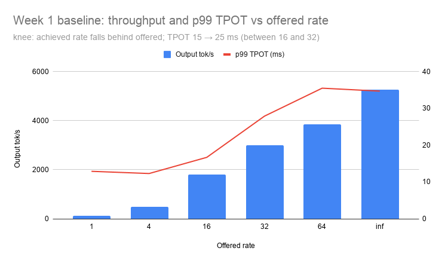

## Hypothesis: (written before each run)

| # | Prediction | Result | Verdict | Lesson
| --- | --- | --- | --- | --- |
| 1 | Idle GPU memory ≈ 16 GB (the model size) | 72.4 GiB: vLLM pre-allocates KV cache up to its 0.92 budget | Wrong | Memory in use => budget vLLM was given != how big the model is. |
| 2 | Prefill for a 2k-token prompt ≈ 104 ms (compute only) | ~140 ms; extra is attention + overhead | Close | |
| 3 | Rate 1: TTFT ≈ 70 ms, TPOT ≈ 11 ms, system output ≈ 128 tok/s | session4_old: 36 ms (warm), 11.3 ms, 127 tok/s; session4: 71 ms TTFT (reproduced 5×), not “36 ms (warm)”. | Right (TTFT lower: no chat template) | 36 ms run was a one-off outlier. |
| 4 | Higher load divides throughput across requests | 127 → 5,264 tok/s (41×) | Wrong: batching multiplies it | |
| 5 | TPOT stays flat under batching | Flat to rate 4, +30% at 16, 3× at inf | Right until the knee | |
| 6 | Same seed twice → lower TTFT *and* TPOT | TTFT drops (cache), TPOT unchanged (decode not cached) | Half wrong | |
| 7 | Warm-up vs run 1: TTFT halves, TPOT same, tails tighten (std and p99 tighten, because warm-up costs are first-time costs paid when the engine meets new kinds of steps, which prefill does and decode doesn’t), prefix cache hit rate ≈ 0, proving caching played no part | no warm-up effect (TTFT: 71.3 / 70.8 / 70.9 ms; TPOT identical; prefix-cache hits ~0) | Wrong | this prediction is a convining story BUT reproducible number = fact |
| 8 | CPU governor (schedutil) causes the rate-1 slowness; setting "performance" drops TTFT to ~40 ms|  67.9 ms TTFT with "performance" setting for CPU governor | WRONG | latency-improves-under-load looked like a CPU power-management signature, but wasn’t here. |


## Variable and constants

Variable: none. This week is the control every later week is compared against.
Within Session 4, request rate is swept (1, 4, 16, 32, 64, inf) to characterise the baseline, not as an experiment.

Constants:
- Model: meta-llama/Llama-3.1-8B-Instruct, BF16 (unquantized)
- Engine: vllm/vllm-openai:v0.31.0-ubuntu2404, all defaults (see config.yaml)
- Hardware: A100 80GB PCIe, GPU 2 on node1, SM clock locked at 1410 MHz, persistence on
- Load: 512 input / 128 output tokens, --ignore-eos, 200 prompts, seeds 43/44 per repeat
- Prefix caching on (default) with random prompts via /v1/completions → ~0% cache hits


## Setup:

Card used: A100 80GB
GPU Used: GPU2
Model used:  Llama-3.1-8B-Instruct
vllm image used: vllm/vllm-openai:v0.31.0-ubuntu2404

```
docker run --gpus '"device=2"' \
  --ipc=host \
  -p 8000:8000 \
  -v ~/.cache/huggingface:/root/.cache/huggingface \
  -e HF_TOKEN=<redacted>\
  vllm/vllm-openai:v0.31.0-ubuntu2404\
  --model meta-llama/Llama-3.1-8B-Instruct
```

Command Breakdown: 

--gpus '"device=2"' : assigns GPU with index 2 to the container.

--ipc=host : shares host's shared memory space with container. Protect vLLM from crashing (due to pytorch shared-memory limits) during inference.

-p 8000:8000: maps container port 8000 to host port 8000 to expose the webserver.

-v ~/.cache/huggingface:/root/.cache/huggingface : stores the model in this location in host so that container can reuse the already downloaded model weights and doesnt need to pull it from scratch.

-e HF_TOKEN= : hugging face token passed as environment variable. mandatory for Llama 3.1, as it is a gated model i.e., requires licence acceptance from the model page.
vllm/vllm-openai:v0.31.0-ubuntu2404 : pulls openai vLLM docker image with tag "v0.31.0-ubuntu2404"

--model meta-llama/Llama-3.1-8B-Instruct : passed as vLLM entrypoint. says which HF model repo to load.


## Results:


### Session 2: what the startup log says


1. VLLM startup log findings:

- The dtype line (confirms BF16): ```dtype=torch.bfloat16```
- How much memory the weights took, and how long loading took:  
  ```Model loading took 15.0 GiB memory and 5.420225 seconds```
  ```Loading weights took 0.87 seconds```
- How much memory went to KV cache, and the number of tokens it can hold:  ```Available KV cache memory: 56.21 GiB``` and ```GPU KV cache size: 460,496 tokens```
- The max_model_len it chose in tokens: ```max model len 131072```
- The "maximum concurrency" line, if present: ```GPU KV cache size: 460,496 tokens, Maximum concurrency for 131,072 tokens per request: 3.51x``


Reference: Actual logs  

(EngineCore pid=326) INFO 10-06 17:00:10 [default_loader.py:484] Loading weights took 0.87 seconds

(EngineCore pid=326) INFO 10-06 17:00:11 [model_runner.py:407] Model loading took 15.0 GiB memory and 5.420225 seconds

(EngineCore pid=326) INFO 10-06 17:00:33 [kv_cache_utils.py:2464] GPU KV cache size: 460,496 tokens, Maximum concurrency for 131,072 tokens per request: 3.51x

(EngineCore pid=326) INFO 10-06 17:00:41 [gpu_worker.py:955] Free memory on device (78.84/79.25 GiB) on startup. Desired GPU memory utilization is (0.92, 72.91 GiB). Actual usage is 15.26 GiB for consumed memory (weights + non-torch), 1.44 GiB for peak activation, and 0.23 GiB for CUDAGraph memory.

(EngineCore pid=326) INFO 10-06 17:00:33 [gpu_worker.py:692] Available KV cache memory: 56.21 GiB


#### Analysis:


1. Memory Budget: 
gpu_memory_utilization=0.92 = 72.91 GiB  (0.92*79.25 GiB VRAM)
weights + Non-torch         = 15.26 GiB
Peak Activation Reserve     =  1.44 GiB

KV Cache = 72.91-15.26-1.44 = 56.21 GiB

Thus, KV Cache is the VRAM remaining after weights and working space (Peak Activation Reserve)
When we change the gpu_memory_utilization (ex: from 0.92 to 0.8), only KV cache is adjusted. Weights, Non-torch, Peak Activation Reserve remains the same. 

2. Why nvidia-smi shows used VRAM as only 72.4 GiB (74143/1024), not 72.91 ? 
when idle, VRAM consumed = Weights(15.26) + KV cache (56.21) + CUDA graphs (0.23) = 71.7 GiB + CUDA context of all GPU process (few 100 MiB usually, here 700MiB) = 72.4 GiB

1.44 GiB of Peak activation reserve: headroom for forward pass; not used memory in idle. 

Hence, Budget != resident. 


3. 15.26 vs 15.0 GiB:
    Weights = 15.0 GiB.
    0.26 GiB “non-torch” = allocator + context overhead. 


4. KV cache size per token:

KV cache size (56.21 GiB) in KiB = (56.21 x 1024 x 1024) KiB
KV cache size in tokens = 460,496 #vllm logs
KV cache per token = (56.21 x 1024 x 1024)/460,496 = 128KiB/token.

5. Cold vs warm start. 

Run 1: model loading 22.07 s. 

Run 2: 5.42 s, with “Loading weights took 0.87 s”. 

Same files, same disk: What changed between runs? 

Linux page cache (buff/cache column of `free -h`) -> model is cached and hence run 2 took less time.
BUT,
Compilation stayed at ~15 s both times, so it isn’t cached across container restarts. 

Question for Week 11: Can a mounted cache directory fix that?

```
root@node1:~$ free -h
               total        used        free      shared  buff/cache   available
Mem:           503Gi        11Gi       377Gi       165Mi       118Gi       492Gi
Swap:             0B          0B          0B
root@node1:~$
```


6. Concurrency:

Total tokens / max model len =   460,496 ÷ 131,072 = 3.51

In worst case scenarion, Only 3–4 requests fit if each uses the full context. 

But, 1,000-token chat request would allow about 460 concurrent requests (460,496/1000) on the same cache. 

Note:
- A100 card’s total VRAM in `nvidia-smi` = 81,920 MiB ÷ 1024 = 80.0 GiB
- vLLM log’s `79.25 GiB total` reports what CUDA can see after the nvidia driver reserves its share.

### Session 3: one request at a time 

[Session3 logs](01-baseline/results/a100-80g/session3/Session3_logs.txt)
[Session3 stream run](01-baseline/results/a100-80g/session3/Session3_stream_run-gpu2-2026-10-11.txt)

1. Token Count: 
   
   Below field will be there in output of each query to the vLLM server.
   
   ```
   "finish_reason":"length",  
   "usage": {  
     "prompt_tokens":45,
      "total_tokens":109,
      "completion_tokens":64, => output completed at 64 tokens as per max_tokens 
      },

    "finish_reason":"stop" => output completed within max_tokens limit
    "finish_reason":"length" => output terminated since it exceeded max_tokens. In this case, "completion_tokens"="max_tokens" 
    "prompt_tokens" => tokens used by user prompt.
    "completion_tokens" => token consumed for query output.  
    "total_tokens"  = prompt_tokens + completion_tokens
    ```

  Note: 
    1. We set max_tokens = 64 in prompt query (check logs) => for short prompt or long prompt, the completion_tokens (or output) can be maximum 64 tokens.
    2. We set min_tokens = 64 in prompt query. This ensures for short prompt or long prompt, the completion_tokens (or output) must be minimum 64 tokens.
    3. Thumb rule: 1 token = ~5.3 characters (or) ~0.75 words
    4. vLLM server exposes a "/tokenize" API endpoint. This can be used to identify the token consumption for a prompt. 


2. Short vs long, 3 runs each, with min_tokens forcing 64: 0.741 vs 0.762 s (cached) and 0.904 s (miss).

check [Session3 stream run](01-baseline/results/a100-80g/session3/Session3_stream_run-gpu2-2026-10-11.txt)

Short prompt: all runs completed ~0.740s. Prefill cache doesnt matter here since prompt length is small.

Long prompt: 

Run 1 (cache miss) - completed in 0.904 s: first chunk at 0.182 s. That’s TTFT: ~140 ms of prefill for 2,065 tokens plus ~40 ms of fixed overhead.
```0.182  data: {"id":"chatcmpl-bdc514b73311a28f","object":"chat.completion.chunk","create```

Runs 2 and 3 (cache hit) - completed ~0.760s: first chunk at 0.042–0.047 s. The prefill vanished; what’s left is request handling, the last partial cache block, and the first decode step.
```0.042  data: {"id":"chatcmpl-a8b01a3009b56981","object":"chat.completion.chunk","create```

Cache miss - cache hit = ~140 ms = prefill compute time.

Decode speed was same in all runs:
i.e, from first content chunck to `[DONE]` took 0.72s 

Ex: run1: first chunk @ 0.182, `[DONE]` @ 0.908 = 0.72s (0.908-0.182)
    run3: first chunk @ 0.047, `[DONE]` @ 0.769 = 0.72s
     
Hence, Decode speed is independent of how long prefill took to get into cache. At 2k tokens, decode speed barely depends on context length.


Note: To find the token count of a prompt, use the model’s own tokenizer only. Because, every model family has its own vocabulary => same text splits differently.


3. Predicted prefill 104 ms, measured ~140 ms; the gap is attention and overhead.

  Billion = 10^9 (1,000,000,000)
  Tera = 10^12 (1,000,000,000,000)

Prefill Compute = 2 maths operations * 8B parameters * prompt tokens

Long Prompt:
For 2000 tokens, how many TFLOP of compute ?  its 2035 tokens incl wrapper/template overhead of 35 tokens.
 (2 x 8 x 10^9 x 2035)/(10^12) = 33 TFLOP 

Short Prompt:
For a 10 token prompt , (2 x 8 x 10^9 x 45)/(10^12) = 0.72 TFLOP

For A100 card, at 312 TFLOPS (TFLOP/s), 
- short prompt: 10 token prompt takes 2.3 ms for prefill compute.
- long prompt:  2000 token prompt takes 105ms for prefill compute.


4. Prefix caching discovered via hidden state; confirmed by editing one early word.


Prefix = leading part of a prompt that is identical to a previous prompt’s leading part. vLLM server caches KV entries for that shared prefix and reuses them. 

- Long prompt's Run1 -> query took 0.904s. 

- But, for Run2,3 of same prompt -> query took only ~0.760s => Prefix was KV cached.

- But when I changed first few words of the prompt, KV cache for Prefix became useless -> query again took 0.904s.

- In vLLM, the flag is `--enable-prefix-caching` (ON by default in the vLLM version used for this test)


5. Decode: 11.5 ms/token ≈ 87 tokens/s ≈ 72% of the 120 tokens/s ceiling.

- Short prompt (45 tokens) took 0.741s. Assume 5ms (0.005s) for prefill compute and HTTP & request handling.  => Total decode time = 0.741 - 0.005 = 0.736s
- We set min_tokens=64 => decode produced 64 tokens as output.
- So time per token = 0.736/64 = 0.0115s = 11.5ms => Tokens / second = 1/0.0115 = 87 tokens/s.
- Session 1 calculation: A100 card produces 120 tokens/s
- (87/120)*100% = 72%. A100 card delivers 72% of its theoretical bandwidth for this workload.
- 28% loss -> kernel launch overhead, attention computation, sampling next token, real memory reads never reach 1.94 TB/s (70-85% of peak is normal)

6. Streaming: TTFT 182 ms (miss) vs 45 ms (hit); decode rhythm unchanged.
   - first three or four chunks in every run arrive ~6 ms apart, then it settles to 11.5 ms.
   - First chunk = role-only header with no token.
   - But that doesn’t explain all of them. This anamoly is added in questions.md page.


### Session 4: load test

```docker run --rm --entrypoint vllm vllm/vllm-openai:v0.31.0-ubuntu2404 bench serve --help=all```

Note:
In a scientific benchmark, you only want to change one variable at a time. in session 4 we change the variable "request rate" i.e., number of requests per second : 1,4,16,32,64,inf.


#### Tool and flags
[check config.yaml](01-baseline/config.yaml)


#### Results table (medians, p99 in brackets, two runs averaged):

| Offered rate | Achieved req/s | Output tok/s | TTFT p50 (p99) ms | TPOT p50 (p99) ms | Max concurrent |
| --- | --- | --- | --- | --- | --- |
| 1 | 0.99 | 127 | 71 (99–115) | 11.7 (12.9) | 8 |
| 4 | 3.88 | 497 | 41 (54) | 11.7 (12.3) | 19 |
| 16 | 14.1 | 1,808 | 53 (74) | 15.0 (16.7) | 57 |
| 32 | 23.4 | 3,000 | 85 (133) | 24.6 (27.9) | 140 |
| 64 | 30.1 | 3,849 | 106 (206) | 33.0 (35.5) | 200 |
| inf | 41.1 | 5,264 | 474 (685) | 33.9 (34.7) | 200 |





#### dmon: what the hardware did

[see concepts.md for sm%,mem% explanation](/inference-lab/concepts.md)

| Rate | Avg power | Peak | SM % | Mem % | Samples below 1410 MHz | Min clock |
| --- | --- | --- | --- | --- | --- | --- |
| 1 | 272 W | 346–380 | 94 | 80 | 18–22% | 1230 |
| 4 | 296 W | 309 | 100 | 87 | 22–27% | 1380 |
| 16 | 278 W | 328 | 97 | 76 | 67–73% | 1335 |
| 32 | 298 W | 313 | 100 | 70 | 88–100% | 1215 |
| 64 | 296 W | 305 | 94 | 64 | 100% | 1185 |
| inf | 276 W | 308 | 93 | 60 | 80–100% | 1230 |


Observation: 
1. From rate 16 onwards, the GPU clock ("Min clock") was below the lock (1410 MHz - set by me) almost all the time. => power cap(300W default/max) determines the clock speed at high rates - "sm_clock" lock has no impact.

2. Mem% decreases (80->60) as load(Rate) increases. But SM% is steady. => as the load increases (high concurrency), the bottleneck to a step shifts towards compute. = hardware level proof of batching-limit.
Note: at inf memory is still ~16 of the 34 ms, so it’s mixed, not compute-bound”.

#### Where the knee is

Check results table, 

At rates 1,4 and 16 achieved (0.99, 3.88, 14.1) = offered (1,4,16).
But from rate32, achieved < offered. i.e., Rate32: 23.4 vs 32, Rate 64: 30 vs 64). So the knee is between 16 and 32.

- Below the knee : the server keeps up and TPOT is flat
- At the knee: 2 things happen at once (achieved < offered, TPOT 15 → 25); 
- Above the knee: each rate doubling buys less throughput and costs more latency.

  - One token costs 16 GFLOP; 200 tokens cost 200 × 16 GFLOP = 3.2 TFLOP. At 312 TFLOP/s for A100 card, 3.2 TFLOP is ~**10 ms**. 
    - At batch 1 compute time(0.05 ms) was way less than memory read time (11ms); 
    - At batch 200 = 16ms memory(weights+KV) + 10ms compute (compute) + overhead and imperfect overlap = ~34ms

batching is free while the model weights dominate memory traffic & compute time is less than memory read time. 
It stops being free when, whichever below comes first.
1. Batch's total KV cache >= size of the model weights, (or) 
2. compute time = memory read time.  

#### Surprises
- when compared to session4_old results, no warm-up effect were observed in TTFT/TPOT during session4 results. 
- session4 TTFT puzzle: cause unknown
  - 71 at rate-1 vs 41 at rate 4, 
  - server-side confirmed by the /metrics histogram, 
  - governor ruled out
  - suspects: chunked-prefill knobs and CUDA-graph coverage for a lone prefill.
- gpu lock (sm_clock) not holding under load.

#### Caveats
- short runs at rates ≥32 (200 prompts in 5–9 s) 
- only 2 repeats for each rate 
- dmon’s 1 Hz sampling gives only 4–8 samples at the fast rates (32,64, inf), so those rows are coarse. 
- --save-detailed missing so no per-request trends.
- power cap decided the gpu clock speed (not sm_clock lock) from rate 16 and above.

## Session 5: SYNTHESIS OF WEEK1 LAB - NO HANDS-ON GPU WORK.

### Bottleneck 

1.  Below knee rates 1,4 -> memory-bound on weights: 
    - For the 8B model we used, weights (+non-torch overhead) = 15.26G 
    - mem read speed of 1.94TB/s => 15.26G this takes 8ms. 
    - A100 card's compute power = 312 TFLOPS. 8B model with BF16 takes 0.016 TFLOP [(2 x 8 x 10^9)/10^12]. 
      - Rate1 compute time :  it takes 0.05ms (0.016/312). 
      - Rate4 compute time: 6 × 0.05 ms ≈ 0.3 ms. Still far < 8 ms memory read.
        - Compute scales with the number of tokens in a step.
        - Number of concurrent requests at rate4 = ~6 
          - max_concurrent_requests = 1.5xrate => 1.5x4 = ~6. 
    - Hence, at rates below knee, workload is purely memory-bound (8ms).

2. Above knee rates 32,64  = high concurrency => KV reads + compute bound; 
    - Compute for 1 token = 16 GFLOP => for 200 tokens, compute = 3.2 TFLOP. A100 card @ 312 TFLOP/s => 3.2 TFLOP takes ~**10 ms** (3.2/312). 
        - Batch/rate 200 takes, 16ms memory (weights+KV) + 10ms compute + 8ms of overhead & imperfect overlap = ~34ms
        - Hence, at rates above the knee, workload becomes balanced - both memory and compute bound.


3. At inf: prefill queueing dominates TTFT.
    - All 200 prompts arrive at t=0, so concurrency hits 200 immediately. 
      - Note: 200 is the number of prompts I sent, not a limit of the card: with 1,000 prompts it would climb until vLLM's "max_num_seqs" (default 256) capped it. A test parameter, not a hardware fact.
    - Each prompt needs 511 (512 set but 511 realized) tokens of prefill, so 200 × 511 ≈ 102k tokens of prefill arrive at once.
      - vLLM engine processes these prefill, one chunk per step, while decode steps are already at 34 ms plateau. => requests wait their turn: TTFT p50 474 ms, p99 685 ms, while TPOT barely changes from rate 64.
      - Cost of saturation shows up in waiting, not in slower decode.
  
### Tradeoff and verdict

- Tradeoff: 
  - For Batch jobs / throughput heavy workloads. run at inf-like load, accept TTFT in hundreds of ms and TPOT 34 ms, get 5,264 tokens/s, 3× the throughput. ex: batch/offline (summarisation jobs, evals - throughput matters)
  - Interactive workloads/latency sensitive worklaods, run at rates less than 16 => a user gets TTFT ~53 ms (p99 74) and TPOT 15 ms (p99 17). 

- Verdict: 
  - A100 80G GPU - Interactive server at or below knee (rate < 25; TTFT ~53ms; TPOT ~15ms) and Batch server at inf rates (5,264/s; TTFT > 100ms; TPOT ~34ms)  
  - Above the knee, each rate doubling buys less throughput & costs more latency.

### Check your understanding:

1. Why is GPU memory almost full before a single request arrives? 

   - VLLM loads the model weights and pre-allocates the remaining free memory for KV cache at startup. This can be adjusted with `gpu_memory_utilization` parameter passed with the vLLM startup command.

2. Why is the first token slower than the ones after it?

   - Due to prefill compute, TTFT (71ms at rate1 & 180ms for 2k prompt) will be way higher than the TPOT(11ms).
   - Because, before the first token the whole prompt must be processed (prefill, compute-bound, grows with prompt length) increases the TTFT; every later token (TPOT) needs just one step.

3. Why does total throughput rise with load while each user's experience gets worse?
   - Throughput increases with batching because the model weight are read only once per step irrespective of batch size. However, beyond the knee, the doubling of load will generate lesser tokens and latency will increase. 
   - Beyond the knee: 
      1. latency increases =>  user experience worsens as steps get longer (time for KV reads and compute grow with batch size).
      2. Prefill queues at inf rates. 

4. Where does "about 16 GB for an 8B model" come from? 

- from vllm startup logs, we can see the datatype is BF16 => it takes 16 bits to store 1 parameter = 2bytes/parameter. Hence for an 8B model, it takes 8x2 billion bytes = 16GB. 


